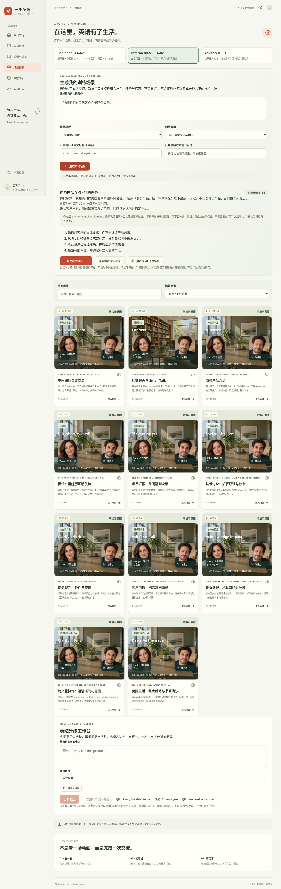

# 一步英语 · Little by Little

面向中文母语的成人中高级英语学习者，用直观教学训练真实沟通。**[打开在线网站](https://chrisjack2380.github.io/english-learning-website/)**，无需注册。已有基础默认 B1–B2，C1 提供论证、条件、语域与隐含意义挑战；入门区保留。等级是教学参考，不是认证或完整等级覆盖。



## 如何学习

首页点击“开始今天的学习”，先复习到期知识，再继续系统路径。每个场景经历真实情境、角色示范、听力意图、表达分析、四轮自主回答与反馈。完成才解锁下一课；自由探索不会跳过必修。记录本地保存，设置可导出/导入学习备份。

**11 个不同的中高级场景**：团队会议、深度 Small Talk、产品介绍、面试、项目汇报、技术讨论、商务谈判、客户需求确认、投诉处理、跨文化协作、租房维修。每个都有角色、原创可暂停动画、三层表达、语法/文化档案、任务标准及 C1 额外要求。另保留六节连续入门课和问候/咖啡/问路三个场景。

场景探索中的“生成我的训练场景”：输入“我想练习向美国客户介绍环保设备”，匹配审核模板，选择 B2/C1，可补产品名称和已知资料；生成完整采购任务，保存到自己的场景库后可重新进入。未知主题需选模板，不凭空杜撰产品能力。默认无需任何 AI API。

**Make My English Natural**：输入 `I very like this product.` 或自己的观点/建议/职责/产品介绍，查看已支持的语法修正、自然/更丰富表达、场合及差异。使用场景表达库和受控组合框架；未知句如实说明限制。规则不是全文语义评估。

## 可选：自己的 AI 模型

学习设置 → AI 模型配置：选择 OpenAI/Claude/Gemini/兼容服务，填模型 ID 和自己的 Key，确认信任地址，测试后保存，选择默认模型。可用于场景改写、自由文本分析，以及同事/朋友/客户/服务人员/面试官的角色接话与追问。请求失败仍可用本地模式，反馈来源明确标记。

**私人 Key 从不进入仓库或学习备份。** 默认仅在页面会话内存，刷新后重新输入；可选口令加密本地保险箱，刷新需解锁，支持锁定/删除。本站没有接收 Key 的服务器；主动测试/使用时浏览器直接向用户选定的模型服务商发送认证信息及练习文本，可能计费，受其权限/CORS/地区限制。不要输入敏感信息。保险箱不能抵御已解锁页面的恶意脚本/扩展，更高安全要求建议用自己的可信后端。详见 [AI 安全说明](docs/AI.md)。

自动化只用明确的 test-only 值与模拟网络；真实供应商连接、费用和模型教学质量未用私人 Key 验收，不宣称已验证。

## 运行与验证

Node.js 24+。

```bash
npm ci
npm run dev
npm test
npm run build
npm run format:check
VITE_BASE_PATH=/english-learning-website/ npm run test:production
npm run preview
```

npm test 包含内容/调度/场景/模型安全测试和凭据扫描。浏览器优先 /usr/bin/chromium，可用 CHROMIUM_PATH；无浏览器时按 Playwright 官方指南安装。现有 Pages Actions 验证子路径后上线并运行实际 HTTPS 流程：

```bash
SITE_URL=https://chrisjack2380.github.io/english-learning-website/ npm run test:online
```

## 架构与扩展

```text
src/scene-schema.ts                    # 场景、角色、环境、教学标准模型
src/scene-catalog.ts                   # 数据驱动的中高级场景库
src/scene-metadata.ts                  # 原场景档案，稳定旧 ID
src/advanced-content.ts                # 注册表及通用 B2/C1 课程工厂
src/scene-generator.ts                 # 审核模板组合、用户场景及 AI 文本校验
src/content.ts                        # 统一内容入口与基础课程
src/communication.ts                  # 透明任务证据、语法及表达框架
src/learning.ts                       # 本地进度、独立先修、复习、备份校验
src/model-config.ts                   # 独立模型偏好、内存密钥及加密保险箱
src/model-api.ts / ai-training.ts      # 可选供应商协议及角色/表达/场景任务
src/ai.ts                             # 后续可信同源后端网关
src/components/CommunicationPlayer.tsx # 通用教学流程，无场景 ID 分支
src/components/CommunicationWorld.tsx  # 原创可配置 SVG 环境与角色
src/pages/                            # 首页、路径、探索、复习、记录、设置
public/audio/                         # 326 段备用合成音频，保留旧 URL
scripts/                              # 增量音频生成与安全扫描
src/*.test.ts / tests/*.e2e.ts          # 单元及真实浏览器验收
output/playwright/                    # 本机实际截图，AI 截图标明 mocked
```

新增场景只加完整结构化数据，自动接入同一页面、课程和动画。扩展说明见 [docs/EXTENDING.md](docs/EXTENDING.md)。维护入口：[REQUIREMENTS.md](REQUIREMENTS.md)、[RULES.md](RULES.md)、[AGENTS.md](AGENTS.md)、[HANDOFF.md](HANDOFF.md)。测试与截图见 [docs/TESTING.md](docs/TESTING.md)，发布见 [docs/DEPLOYMENT.md](docs/DEPLOYMENT.md)。

实际采用 React 19 / TypeScript / Vite、Lucide、原创 SVG/CSS、Web Crypto、浏览器 TTS/语音识别与备用 MP3；Vitest、Playwright、Prettier。没有新框架或供应商 SDK 依赖。已使用 cloud-environment-onboarding:setup 做环境初始化；官方技能/开源研究及许可证见 [docs/RESEARCH.md](docs/RESEARCH.md)，未新增安装其他 Skills。

## 已知边界

本地检查只按任务词语、长度及有限语法规则；不能完整判断语义、事实、真实发音或 CEFR 水平。AI 建议亦需核对，不能自动授予能力。用户自定义任务目前受审核模板约束，AI 不能更改评分规则。

数据只在当前浏览器；学习备份不含模型配置或独立自定义场景库，后者最多 12 个。清理站点数据、更换设备、无痕模式可能丢失。未完成的课程步骤刷新后重来，已完成进度/输出可恢复。

播放优先设备 TTS，固定场景与默认采购模板有备用合成音频（约180词/分钟、0.7×慢速），声音机械。任意产品名/AI动态句子依赖设备 TTS，否则用文本继续。语音识别取决于浏览器、HTTPS、麦克风权限和厂商服务，不是发音评分。真人录音、多口音、真人麦克风、Safari/Firefox 尚未验收。

后续方向：更完整 C1/学术论证、医疗/银行/保险等复杂生活任务、真人语音、更复杂动画、可信 AI 后端、长期规划和账号同步。当前线上发布及 Git 状态以 HANDOFF 的实际记录为准。
