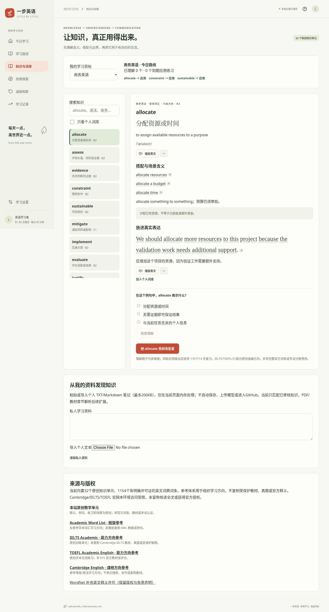

# 一步英语 · Little by Little

**[打开在线网站](https://chrisjack2380.github.io/english-learning-website/)**。面向中文母语成人的知识与沟通训练：理解含义 → 分析搭配 → 生成场景 → 自主输出 → 反馈 → 复习。已有基础默认 B1–B2，保留 C1 挑战和入门课程；等级用于教学定位，不是认证。



## 如何学习

首次选择水平、每天时长与目标：IELTS、TOEFL、商务、工作或日常交流。成人首页“开始今天的学习”进入目标知识路线，优先到期应用，再推荐新知识；“继续系统沟通课”保留连续课程。

知识库当前有 **32 个原创词汇、短语和语法单元**，每项包含双语含义、音标、常见搭配、例句、用法区别、理解题和场景任务。理解后点击“把 … 用到场景里”，完成听力、表达分析及四轮自主输出；应用后按 1/3/7/14 天复习，错误或使用支架安排巩固。只浏览、理解题或探索不会跳过必修课程。

英文词、选中的短语和整句均可查词：原创单元提供详细中英释义；补充 **1154 个合法 WordNet 英文词条**，按需本地加载。未收录中文/音标如实提示；可保存个人摘词和中文笔记。粘贴或导入自己的 TXT/Markdown（最多200KB）发现已收录知识，原文仅当前页面内存处理，可一键清除，不自动保存或发送模型。暂不解析 PDF 教材。

保留 **11 个不同中高级场景、22 个 B2/C1 系统任务**：会议、深度 Small Talk、产品介绍、面试、汇报、技术讨论、谈判、客户需求、投诉、跨文化协作、租房维修，以及六节入门和三个基础场景。本地需求生成使用审核模板与用户事实，没有 AI 也能完整训练；未知领域需选模板。

开放回答提供“正确性、自然度、语境、升级”四层反馈和明确自评，已知用法错误解释后修正；不再用词数或关键词判断沟通能力。Make My English Natural 提供受控表达库及可选模型分析。过去已结束与仍持续的工作经历先确认再选时态，不擅自改成职责。

提交回答后角色预设回复自动播音，支持同步句子提示、重播、0.7×和审核中文。照片风格虚拟角色/环境为原创 AI 素材，配合可暂停动效与步骤变化；可切回 SVG 示意图。不是真人录像或嘴形同步。

## 可选个人 AI

设置 → AI 模型配置，选择 OpenAI/Claude/Gemini/兼容服务，填个人 Key、模型 ID，确认信任地址，测试后保存/设默认。可用于场景改写、表达分析、即时词典解释和动态角色接话。场景内明确开启“提交后使用我的 AI”才在回答后自动请求，随时关闭；失败仍保留本地学习。

Key 默认仅会话内存，可选口令加密本地保险箱，支持锁定/删除；不会进入 Git 或学习备份。本站没有收集 Key 的后台，主动使用时浏览器向选定供应商发送认证及练习文字，可能计费并受 CORS/权限限制。真实供应商连接/模型质量未用私人 Key 验收，协议测试使用明确 mock。详见 [AI 安全说明](docs/AI.md)。

## 运行与验证

Node.js 24+：

```bash
npm ci
npm run dev
npm test
npm run format:check
VITE_BASE_PATH=/english-learning-website/ npm run test:production
npm run preview
```

Chromium 优先 /usr/bin/chromium，可设 CHROMIUM_PATH；没有浏览器时按 Playwright 官方方式安装。Pages Actions 验证生产子路径并发布，再在 GitHub 托管 Chromium 验收实际公开 HTTPS：

```bash
SITE_URL=https://chrisjack2380.github.io/english-learning-website/ npm run test:online
```

测试结果、真实截图与部署记录见 [docs/TESTING.md](docs/TESTING.md)、[HANDOFF.md](HANDOFF.md)。

## 架构与扩展

```text
src/knowledge.ts                       # 原创知识和合法出处
src/knowledge-learning.ts              # 目标路线、理解/应用/复习、知识→场景
src/feedback.ts                        # 开放输出四层反馈，明确能力边界
src/scene-schema.ts / scene-catalog.ts  # 结构化场景数据库
src/advanced-content.ts / content.ts    # 通用系统课程工厂、入门内容
src/scene-generator.ts                 # 模板生成、用户场景、AI文本白名单
src/learning.ts                        # 本地进度和备份校验，兼容原v1记录
src/model-config.ts / model-api.ts     # 独立模型配置、安全协议、保险箱
src/ai-training.ts / ai.ts             # AI任务与未来可信后端契约
src/components/KnowledgeContext.tsx    # 查词、个人摘词与选择短语
src/components/CommunicationPlayer.tsx # 通用教学与角色互动
src/components/AutoDialogue.tsx        # 自动语音和字幕状态
src/pages/Knowledge.tsx                # 知识路线与私人阅读入口
public/dictionary/                    # WordNet子集与完整许可证
public/visuals/                        # 原创虚拟角色/环境素材
public/audio/                         # 604段备用合成音频，保留旧URL
src/*.test.ts / tests/*.e2e.ts          # 单元及真实浏览器流程
output/playwright/                    # 本机实际截图；mock文件明确标记
```

扩展知识见 [docs/KNOWLEDGE.md](docs/KNOWLEDGE.md)，场景/课程见 [docs/EXTENDING.md](docs/EXTENDING.md)。长期维护入口：[REQUIREMENTS](REQUIREMENTS.md)、[RULES](RULES.md)、[AGENTS](AGENTS.md)、[HANDOFF](HANDOFF.md)。

实际采用 React19、TypeScript、Vite、Lucide、SVG/CSS、Web Crypto、浏览器语音与备用 MP3，Vitest/Playwright/Prettier。无新框架、供应商 SDK 或付费依赖。应用 cloud-environment-onboarding:setup 核对环境；未新增其他 Skills。研究、授权数据与素材出处见 [docs/RESEARCH.md](docs/RESEARCH.md)。

## 当前边界

32 个单元是原创试行课程，不是 Cambridge/ETS 授权教材、官方六级/AWL全表、完整备考体系或考试分数预测。未收录知识不能任意生成专业课程；本地反馈不完整判断语义、事实、发音或 CEFR，模型建议亦需核对。

数据在当前浏览器保存；设置可导出/导入学习和个人词库，模型配置、自定义场景库不含在学习备份。换设备、清理数据或无痕模式不会自动同步。未完成步骤刷新后重来，已完成记录恢复。

固定语音为合成声音，动态 AI 句子需设备 TTS；自动播放受浏览器限制，阻止时可重播。原生 TTS 边界突出当前句，MP3用整句提示，不宣称精准逐词时间轴。真人麦克风、真实供应商、Safari/Firefox和实机触屏未验收。后续扩展合法教材解析、更多知识、长篇论证、真人语音、更复杂动画、可信后端和长期能力模型。
